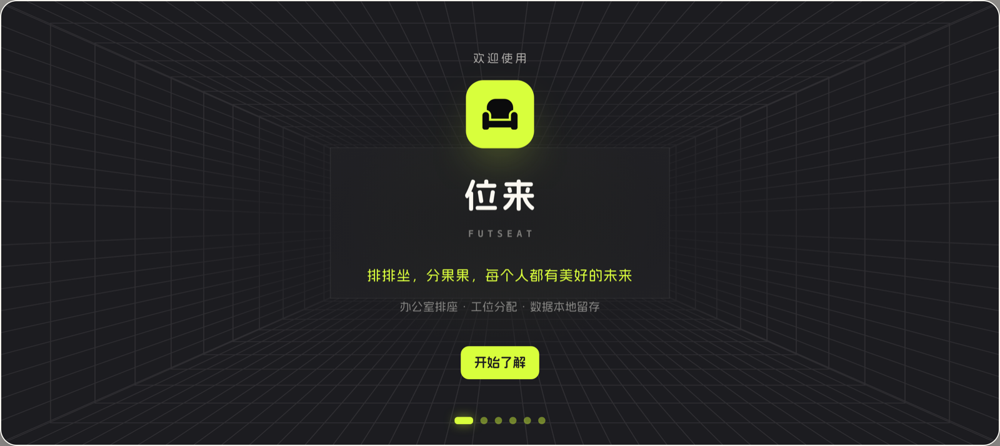

# 位来 · FutSeat

> 排排坐，分果果，每个人都有美好的未来。

办公室布局与工位管理的单文件网页应用。画墙、摆桌椅、排座位，一张图管清楚谁坐哪儿。

## 它解决什么

搬新办公室、部门调整、临时项目组——每次排座位都是一场 Excel 拉锯战：谁挨着谁、哪个部门靠窗、新来的坐哪儿。

位来把这件事变成「在一张平面图上摆椅子」：**布局存几何，方案存分配**，同一张图可以排多套互不干扰的座位方案。

## 功能

- **画办公室** — 正交墙折线 + 门 + 矩形桌 + 方形椅；拖拽、缩放、四角拉伸、吸附、碰撞阻挡
- **排工位** — 每把椅子就是一个工位，有编号、可分配员工；方案之间自由切换
- **管人员** — 部门树 + 员工名单，Excel 导入导出，支持下钻筛选
- **出图** — 黑白版 PNG 平面图 + Excel 座位表，直接打印上墙
- **分享** — 给对方一个离线 HTML 文件，或一条几十字符的短链；只能看和导出，改不了你的库

## 怎么用

1. 下载 `index.html`
2. 双击，用 Chrome 打开（单文件，不需要装任何东西）
3. 载入示例布局，或者自己从画墙开始

没有账号、不用注册。数据存在浏览器本地，换电脑靠「导出存档 / 载入存档」搬迁。除了「生成短链」那一步，其余功能全程离线。

## 技术上的几个选择

- **单个 HTML**，约 1.8 MB：样式与脚本全部内联，首屏 1 个请求、零外链，拷到 U 盘就能带走
- **原生 JS + SVG**，没有框架、没有构建步骤、没有 `node_modules`
- 画布统一用**米**做单位，缩放基准 60 px/m，所有尺寸常量收在一处
- 椅子图形全部用米制填充绘制，不用 `stroke-width`——否则缩放时椅背和座面不成比例
- 图标取 Font Awesome 的 SVG path 内联，字体是子集化后的 base64

## 已知边界

- 只支持正交墙折线和矩形桌，没有弧形墙、圆桌、斜桌
- 碰撞逐帧检测，拖得极快时一帧可能跨过薄墙
- 不跨设备：数据只在这台电脑的浏览器里，清缓存就没了；分享是单向只读通道，对方不能把方案存回自己的库

## 关于

个人项目：设计与产品由我负责，代码绝大部分由 AI 协作完成，规则、计划和复盘都留在仓库外的本地文档里。

图标为 Font Awesome Pro 的 SVG path，字体为子集化内联字体——**如需二次分发或商用，请自行替换为你有授权的资源**。
